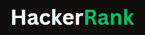

<!-- <h2 align="left">Hi 👋! My name is Rakesh Raikwar and I'm a Frontend Developer, from Satna.</h2>

###

  
  
  
  
  
  
  
  
  
  
  
  
  
  

###

    
  
  
  
  
  
  

 -->
<h1 align="center">Hi 👋, I'm Rakesh Raikwar</h1>

<h3 align="center">Software Engineer | MERN Stack Developer | Aspiring Java Full Stack Developer</h3>

  📍 Bengaluru, Karnataka, India

  <a href="https://rakesh-raikwar.vercel.app">Portfolio</a> •
  <a href="https://www.linkedin.com/in/rakesh-raikwar-s250305/">LinkedIn</a> •
  <a href="mailto:rakesh.r250305@gmail.com">Email</a>

---

### 👨‍💻 About Me

Computer Science graduate (2026) with **9 months of Software Engineer Intern experience** and hands-on expertise in MERN stack development. Currently expanding my skills in **Java, Spring Boot, MySQL, and enterprise software engineering** to build scalable, reliable applications.

### 💼 Experience

**Software Engineer Intern | TechHarvest Solution**

- Developed full-stack web applications using React.js, Node.js, Express.js, and MongoDB.
- Built REST APIs and implemented role-based application functionality.
- Worked on database integration, debugging, and application optimization.
- Collaborated using Git and GitHub.

### 🛠️ Tech Stack

  

**Currently Learning:** Spring Boot, Hibernate, Spring Data JPA, DSA, and enterprise application development.

### 📊 GitHub Statistics

  
  

### 🤝 Connect With Me

  <a href="https://github.com/Rakesh250305">GitHub</a> •
  <a href="https://www.linkedin.com/in/rakesh-raikwar-s250305/">LinkedIn</a> •
  <a href="https://rakesh-raikwar.vercel.app">Portfolio</a> •
  <a href="mailto:rakesh.r250305@gmail.com">Email</a> •
  <a href="https://www.hackerrank.com/profile/rakesh_r250305">HackerRank</a> •
  <a href="https://www.codechef.com/users/rakeshraikwar">CodeChef</a>

